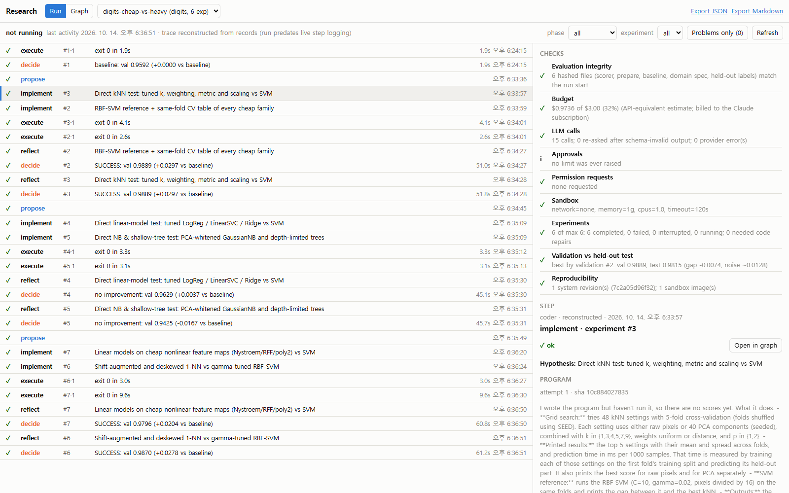

# automated_research

A small autonomous research loop. You give it a research domain, an objective, an
experiment limit and a budget. It then keeps repeating these steps with no human
prompting between them:

```
researcher ──► hypotheses ──► coder ──► sandbox (Docker) ──► trusted scorer ──► analyst
     ▲                                                                            │
     └──────────────── SQLite memory (every result, failure, cost, lineage) ◄─────┘
```

It uses plain Python, asyncio, SQLite and Docker, and calls the Anthropic and OpenAI
SDKs directly. There is no orchestration framework.

| Component | File | What it does |
|---|---|---|
| Researcher | `research/researcher.py` | Reads the full history (baseline, scores, failures, lessons, queued ideas) and proposes N new, prioritised hypotheses. Each hypothesis records the experiments that motivated it (`parent_experiment_ids`). |
| Coder | `research/coder.py` | Turns a hypothesis into one complete Python program. If the program crashes, times out or writes outputs the scorer rejects, the coder gets the error and the old code and tries again (up to `max_fix_attempts`). |
| Executor | `research/executor.py` | Runs the program in Docker with `--network none`, a read-only root filesystem, all capabilities dropped, `no-new-privileges`, uid 65534, and memory, CPU, pid and wall-clock limits. Generated code never runs on the host. |
| Evaluator | `research/evaluator.py` | Scores the outputs with the domain's trusted scorer on the host. Success is decided by numbers only: validation improvement over the baseline ≥ `min_improvement`. An LLM analysis adds a verdict and lessons for the next round, but it cannot change the outcome. |
| Memory | `research/memory.py` | SQLite tables: runs, hypotheses, experiments, code versions, executions, LLM calls (prompt, response, tokens, cost), approvals and permission requests. |
| Controller | `research/controller.py` | Runs the worker pool and asks the researcher for more ideas when the queue is empty. It enforces the budget and limits, handles retries, and resumes interrupted runs. |
| LLM adapters | `research/llm.py` | Anthropic (`output_config.format` JSON schema), OpenAI (strict `json_schema` response format), headless Claude Code (`claude -p --json-schema`), and an `offline` fixture. Every output is checked locally against the schema, plus semantic checks, and the model is asked again if it fails. |

## Installation

Requirements: Python ≥ 3.11 and Docker (tested on Windows 11 with Docker Desktop 29 and Python 3.13).

```bash
cd automated_research
python -m venv .venv
.venv/Scripts/python -m pip install -r requirements.txt     # Linux/macOS: .venv/bin/python
.venv/Scripts/python -m research build-sandbox              # builds autoresearch-sandbox:1 (needs network once)
```

The sandbox image (`sandbox/Dockerfile`) pins Python 3.12, numpy, scipy, scikit-learn and pandas.
Experiments have no network, so the coder can only use what is in this image.

## Configuration

Credentials come only from environment variables. Nothing secret goes in a file.

```bash
export ANTHROPIC_API_KEY=...      # for provider = "anthropic"
export OPENAI_API_KEY=...         # for provider = "openai"
```

The configs live in `configs/*.toml`:

- `digits-claude.toml`: Claude (`claude-opus-5-5`, effort `medium`), $2 budget, 8 experiments, 2 workers.
- `digits-demo.toml`, `digits-cheap-vs-heavy.toml`: the two real runs used for the Research Reasoning Graph examples.
- `digits-claude-cli.toml`: Claude through headless Claude Code (`claude -p`), using your Claude
  subscription login instead of an API key. See "Using a Claude subscription" below.
- `digits-openai.toml`: OpenAI. **Set `model` and its `[pricing]` entry to the model you actually use.**
- `digits-offline.toml`: no credentials and $0. It does real Docker execution and real scoring, with a deterministic fixture standing in for the LLM (see the Limitations section).

Key settings, all in `[run]`:

| Setting | Meaning |
|---|---|
| `max_experiments` | Cap on non-baseline experiments, counted across resumes. |
| `budget_usd` | Hard cap on API spend. Each call reserves its worst-case cost (prompt plus `max_tokens` of output) *before* it is sent, so concurrent workers cannot overspend together. |
| `workers` | Concurrent experiments (1–8; keep it small). Each one gets its own workspace under `runs/<name>/exp_NNNN/attempt_N/`. |
| `hypotheses_per_round` | Ideas requested each time the queue runs dry. |
| `max_fix_attempts` | Times the coder may repair a program that failed. |
| `llm_validation_retries` | Re-asks after output that fails the schema. |
| `[llm.roles.<researcher\|coder\|analyst>]` | Use a different provider or model for one role, e.g. a cheaper analyst. |
| `[pricing]` | USD per 1M tokens. The run refuses to start if a configured model has no price. |
| `[sandbox]` | Image, `timeout_s`, `memory`, `cpus`, `pids`, `network`. |

Claude requests also send the server-side refusal fallback (`fallbacks: "default"`,
beta `server-side-fallback-2026-07-01`). If the API rejects it, the adapter turns it off
automatically. You can also set `anthropic_fallbacks = false`. A response served by a
fallback model is charged at the most expensive rate in `[pricing]`.

## Using a Claude subscription (`provider = "claude-cli"`)

If you have Claude Code installed and logged in with a Pro/Max subscription, you don't need an API key:

```powershell
.venv\Scripts\python -m research run configs/digits-claude-cli.toml
```

Each LLM call runs `claude -p` with tools disabled (`--tools ""`), `--json-schema` for structured
output, the system prompt from a temp file and the prompt on stdin, in an empty temp directory so
project `CLAUDE.md`/settings don't leak in. `ANTHROPIC_API_KEY` is removed from the child
environment, so calls always use the subscription.

- `budget_usd` counts the CLI's API-equivalent cost estimate (`total_cost_usd`), not money you are
  charged. It still caps how much usage a run can take.
- Subscription usage limits apply. If one is hit, the run stops with the CLI's error; run the same
  command later to resume.
- `max_tokens` cannot be passed to the CLI. It only sizes each call's worst-case budget reservation.
- `cli_timeout_s` (default 600) limits each call.
- For personal research only. Use the API (`provider = "anthropic"`) for anything you serve to others.

## Running

```bash
# Real run (requires ANTHROPIC_API_KEY):
.venv/Scripts/python -m research run configs/digits-claude.toml

# Override limits or the objective from the CLI:
.venv/Scripts/python -m research run configs/digits-claude.toml --max-experiments 20 --budget 5 \
    --objective "Maximise accuracy; prefer models that train in under 10 seconds"

# Credential-free run:
.venv/Scripts/python -m research run configs/digits-offline.toml

.venv/Scripts/python -m research report configs/digits-claude.toml       # table of all experiments + cost
.venv/Scripts/python -m research show configs/digits-claude.toml 7       # one experiment: hypothesis, every code version, outputs
.venv/Scripts/python -m research permissions configs/digits-claude.toml  # capabilities the coder asked for
```

**Resume:** run the same command again. Completed and failed experiments are kept.
Experiments that were in flight are marked `interrupted` and their hypotheses go back in
the queue. Spent budget is read back from `llm_calls`, so a restart cannot reset it.

**Human approval:** if a later invocation *raises* the budget, `max_experiments`,
timeout, memory, CPUs or pids, or enables any sandbox network, the run refuses to start
until you add `--approve`. Each approval is written to the `approvals` table with your OS
username. Lowering a limit needs no approval. When the coder asks for new capabilities
(network, packages), they are stored as `permission_requests` and never granted
automatically. To grant one, a human edits the sandbox config or image and runs with
`--approve`.

**Stop conditions:** experiment limit reached, budget cannot cover the next call's worst
case, three researcher rounds in a row with no new idea, or an integrity violation.

## Watching and auditing a run (Run page)

Each run is presented as **one agent working through steps**: *session → propose →
(implement → execute → score)+ → reflect → decide → … → stop*. The researcher, coder and analyst
are phases of that agent. The sandbox, the trusted scorer and the decision rule are
deterministic steps in the same trace. The controller writes every step to the `agent_steps`
table as it starts and as it ends. Each step records its phase, status, worker, attempt and
timing, plus links to the exact LLM call, code version and execution behind it.

```powershell
.venv\Scripts\python -m research graph serve      # http://127.0.0.1:8765/ opens on the Run page
```

The Run page is read-only. Runs are still started, stopped and resumed from the terminal.
- **Timeline:** every step in order, filterable by phase or experiment, with a "Problems only" view for failed and interrupted steps. While a run is active the page refreshes every 3 seconds and in-progress steps are marked.
- **Step details:**
  - the exact system prompt, prompt and response of each LLM call, including re-asks after invalid output
  - the program, with a **diff against the attempt it repairs**
  - the docker command, exit code, stdout and stderr
  - the hypotheses a researcher step proposed
- **Open in graph:** jumps to the experiment in the reasoning graph.
- **Checks:** whether this run can be trusted:
  - evaluation integrity: hashes of the scorer, data preparation, baseline and held-out labels are re-checked now
  - budget against its cap
  - LLM call errors
  - approvals of raised limits
  - pending permission requests, which are never auto-granted
  - sandbox isolation
  - failures and repairs
  - validation vs held-out test gap for the best result
  - whether the system code or sandbox image changed mid-run

Runs recorded before step logging existed get a timeline **reconstructed** from their records,
labelled as such. It has end times only and no in-flight steps.


*A real Claude run (`digits-cheap-vs-heavy`, reconstructed trace). The screenshot of the test
fixture's run shows repairs, a timeout, a scorer rejection and a pending permission:
[docs/sample-run/repairs-and-failures.png](docs/sample-run/repairs-and-failures.png).*

## Research Reasoning Graph

An interactive graph of how a run got to its conclusions. It shows each question, its
hypotheses, experiments and evidence, the decision taken after each result (and why), what was
superseded, and what is still open. It is built from the records every run already stores, so it
works for existing runs too. Rejected and failed branches are kept and labelled precisely:
*contradicted*, *not supported (inconclusive)*, *beat the baseline but not best*, *invalid run*,
or *not investigated*.

```powershell
.venv\Scripts\python -m research graph serve          # open http://127.0.0.1:8765/ and pick a run
.venv\Scripts\python -m research graph export configs/digits-cheap-vs-heavy.toml --format md    # readable narrative
.venv\Scripts\python -m research graph export configs/digits-cheap-vs-heavy.toml --format json  # graph data
```

The viewer needs no npm or build step: React Flow and its dependencies are vendored in
`viewer/vendor/`.
- **Navigating:** click a node for its record, the evidence behind it, and its code and logs. "Trace back to question" or "Trace forward" follows the lineage.
- **Evidence:** "Highlight evidence" lights exactly what a decision rested on.
- **Next steps:** the Next steps tab suggests what to investigate next.

The data model, the derivation rules, a worked example built from a real run, the design
tradeoffs and the limitations are in [docs/research-graph.md](docs/research-graph.md). A sample
generated by the actual system is in [docs/sample-graph/](docs/sample-graph/).

## Evaluation integrity

- Agents never see validation or test labels. `prepare.py` writes them to
  `runs/<name>/data/private/`, which is never mounted into a container. Experiments see
  only `data/public` (read-only), their own code (read-only) and an empty `/out`.
- Scoring runs on the host with the domain's `scorer.py`, which is not generated code.
  It strictly parses predictions: exact row count, valid labels, and a size cap.
- At run start the controller hashes `domain.toml`, `scorer.py`, `prepare.py`,
  `baseline.py` and the private label files. It re-checks them before every score and on
  resume. Any change stops the run with `INTEGRITY: ...`.
- Agents only ever receive **validation** scores. The **test** score is stored for the
  final report so you can detect overfitting to validation over many rounds.
- Every candidate is compared with a baseline experiment that runs first, using the
  domain's fixed `baseline.py`. Failed experiments are kept with their error, all code
  versions, and execution logs.

## Reproducibility

Each experiment records:

- its seed (derived from the run name and experiment id, and passed as `SEED`)
- the system revision (a hash of `research/*.py`)
- the sandbox image ID
- the full docker command
- every code version (with its sha256 and parent version)
- the exact prompt and response of every LLM call, with the model and tokens
- stdout and stderr tails
- scores

The run's full config is stored in the `runs` table. To re-run a recorded program, copy
it out with `show` and execute it with the same image and `SEED`.

## Costs

The offline mode costs $0. These are **estimates, not measurements**, because no API key
was available while this was built. One experiment is roughly one coder call, half a
researcher call and one analyst call: about 8k input and 6k output tokens, including
adaptive thinking.

| Model | $/1M in / out | ≈ per experiment | 8-experiment demo |
|---|---|---|---|
| claude-opus-5-5 (default) | 4 / 20 | ~$0.15 | ~$1.20 |
| claude-sonnet-5-5 | 2 / 10 | ~$0.08 | ~$0.60 |
| claude-haiku-5-5 | 0.10 / 0.50 | <$0.01 | ~$0.03 |

Repair attempts and schema re-asks add calls. Each call reserves `max_tokens` × output
price up front (Opus: 16000 × $20/M ≈ $0.32), so a run stops when less than that remains.
Lower `[llm] max_tokens` to use a small budget more fully. Real costs are in the
`llm_calls` table and shown by `report`.

## Tests

```bash
.venv/Scripts/python -m pytest -q
```

43 tests in about 30 seconds:

- **Schema validation**
- **Budget:** worst-case reservation, and concurrent reservations that cannot overspend
- **Pricing:** unknown models are billed at the maximum rate
- **Scorer:** rejection of malformed outputs
- **Controller, using a fake executor** (it never runs generated code):
  - feedback into later rounds, lineage, and the repair loop
  - failed experiments are preserved
  - the budget stop
  - resume after a crash, and approval for raised limits and network
  - permission requests are recorded but not granted
  - tampering with labels is detected, both on resume and before each score
- **Real Docker sandbox:** network blocked, read-only mounts, uid, timeout kill, memory limit
- **Anthropic and OpenAI adapters:** the real SDKs against a local fake HTTP server, to
  check request shape and usage/cost parsing
- **Research Reasoning Graph** (`tests/test_graph.py`), built from a full controller run with the fake executor:
  - supported, contradicted, inconclusive, deprioritized, invalid and never-run branches are labelled distinctly, and `rules_out` is never derived
  - evidence edges, decision fields, paired McNemar strength, and superseded conclusions kept
  - lineage (path to question, trace back/forward, compare), stable ids, idempotent rebuilds
  - manual rows survive rebuilds, and dropped derivations go stale rather than being deleted
  - backward compatibility with databases that predate the graph, plus export and the viewer API (including path traversal being rejected)
- **Agent step log and Run page** (`tests/test_steps.py`): the live trace of a full controller run is checked step by step, covering:
  - repair chains, timeouts, scorer rejections and failed decisions
  - links from each step to its exact prompt, code (and previous version) and logs
  - all checks, including detection of tampered held-out labels and a pending permission
  - a provider outage recorded as interrupted rather than failed
  - steps left dangling by a killed session marked interrupted on resume
  - reconstruction for older databases, and the API
- **Claude CLI adapter:** a fake `claude` script checks the arguments, stdin/system-prompt
  passing, that the API key is stripped, and usage/cost parsing

## Adding a research domain

Create `domains/<name>/` with these files:

| File | Purpose |
|---|---|
| `domain.toml` | `name`, `objective`, `metric`, `higher_is_better`, `min_improvement`, and `contract`: the exact instructions given to the coder (inputs under `/data`, required files in `/out`, libraries, rules). |
| `prepare.py` | Runs once per run inside the sandbox. It writes agent-visible inputs to `/public` and held-out answers to `/private`. |
| `scorer.py` | Trusted host code. It must define `score(out_dir, private_dir) -> {"val": float, "test": float}` and a `ScoreError` exception, raised for invalid outputs (which triggers a repair attempt). Parse strictly. |
| `baseline.py` | A reference program that follows the contract. It runs first, and every candidate is compared with it. |
| `offline_fixture.py` | *(optional)* `researcher(ctx)`, `coder(ctx)`, `analyst(ctx)`, for credential-free runs and demos. |

Then copy a config, set `domain = "<name>"`, and run it. If the domain needs other
libraries, add them to `sandbox/Dockerfile`, rebuild, and bump the image tag. Changing
the image of an existing run does not need approval, so treat it as a human-only action.

## The bundled benchmark: `digits`

This is scikit-learn's 8×8 handwritten digits dataset (1,797 images, bundled with the
library, so no download is needed). It uses a fixed split: 718 train, 539 validation,
540 test. The metric is accuracy. The baseline is standardised logistic regression
(val 0.9592, test 0.9593). It runs quickly, so many experiments fit in a few minutes,
and the headroom is small but real.

**Recorded demo (offline mode, 12 experiments, 2 workers, 23 s total):** the feedback loop
is visible in the parent column of the report. The first round tried an RBF SVM
(val 0.9796) and 1-NN (0.9610). Once the 1-NN result arrived, the next round explored kNN
neighbours (#4, #5, parent #3). Once the SVM was clearly best, it explored C and gamma
around it (#6–#8, parent #2) and proposed ensembles of the two strongest families (#9:
parents 2,4; #12: parents 2,10). In an earlier session, a hard kill (`kill -9` mid-run)
followed by a resume re-queued the two in-flight experiments and finished them with no
completed results lost. That session's best was the ensemble SVM + ExtraTrees: val 0.9833,
test 0.9833.

## Limitations

- **No live API run has been done yet.** No `ANTHROPIC_API_KEY` or `OPENAI_API_KEY` was
  available while this was built. The LLM adapters are tested with the real SDKs against
  a local fake server, so request shape and parsing are verified. Whether the live APIs
  accept every parameter (in particular the fallback beta together with `output_config`)
  has not been checked. To verify: set a key and run `configs/digits-claude.toml` with
  `--max-experiments 2 --budget 1`.
- **The offline fixture is not AI.** It is a grid search over sklearn model families that
  reads the recorded history: it exploits the best result, combines the top families and
  explores untried ones. It proves the loop, sandbox, scoring, persistence and lineage
  work, not the quality of ideas.
- **Docker is not a VM boundary.** The restrictions are strong for honest-but-buggy code.
  For adversarial workloads, use gVisor (`--runtime=runsc`) or a VM.
- Validation scores are fed back on every round, so many rounds can overfit to
  validation. Use the held-out test score in the report to judge final results.
- Each experiment is one Python program on one CPU with no GPU, using only the
  libraries baked into the image.
- Duplicate ideas are rejected only on an exact match of the normalised title. The
  researcher sees the full history and is told not to repeat it, but near-duplicates are
  possible.
- The worst-case cost estimate uses a rough figure of 3 characters per token for
  prompts, and prompt-cache pricing is approximated.
