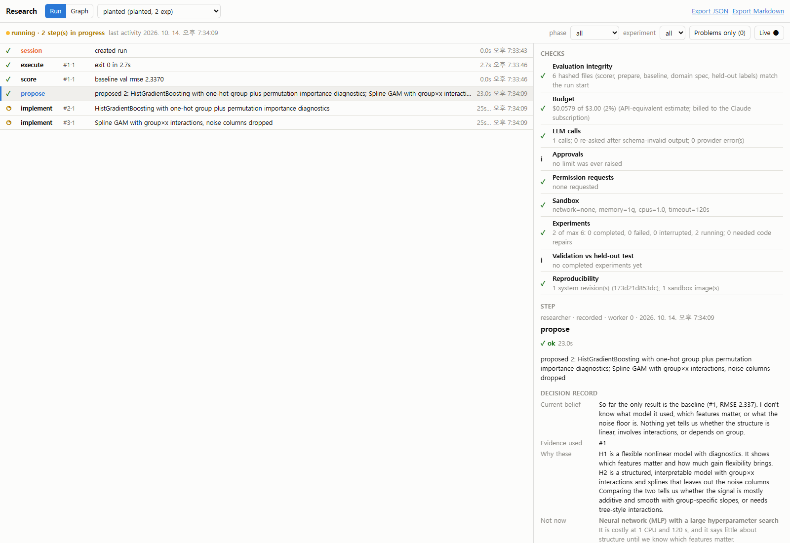

# Formulating a problem and testing the agent

## 1. What a "problem" is here

A problem is a **domain**: a folder under `domains/<name>/` with four files.

| File | You decide | Who sees it |
|---|---|---|
| `domain.toml` | the **objective** (your research question), the **metric**, whether higher is better, the **success threshold** (`min_improvement`), and the **contract**: the exact instructions the coding agent gets (inputs, required outputs, libraries, rules) | the agent |
| `prepare.py` | how the raw data becomes agent-visible inputs (`/public`) and hidden answers (`/private`). It runs once per run, in the sandbox, and reads your files from `/raw` (= `domains/<name>/data/`) | you only |
| `scorer.py` | `score(out_dir, private_dir) -> {"val": x, "test": y}`. It parses outputs strictly and raises `ScoreError` on anything malformed. It runs on the host and is never generated | you only |
| `baseline.py` | a simple, honest reference solution. Every experiment is compared with it | runs first |

A problem fits this agent when:
- **One program, one score:** a single Python program can produce outputs that a fixed scorer can grade with one number.
- **Held-out answers exist:** there's a validation split for the agent and a test split for you.
- **It fits the sandbox:** one CPU, no GPU, no network, about 2 minutes per run by default, using numpy, scipy, scikit-learn and pandas.

Classification, regression, ranking, forecasting with a fixed horizon, and "find parameters that minimise a checkable cost" all fit. Open-ended writing, anything needing internet or a GPU, and anything without a trustworthy scorer do not.

## 2. Fast path: a CSV and a target column

```powershell
# 1. scaffold: domain files + configs/<name>.toml (task inferred from the target; override with --task)
.venv\Scripts\python -m research new-domain churn --csv C:\data\churn.csv --target churned `
    --objective "Predict churn as accurately as possible, and find out which customer signals matter most."

# 2. review domains\churn\domain.toml   <- objective, min_improvement, contract
# 3. prove the domain is sound - no LLM, no cost
.venv\Scripts\python -m research check-domain churn

# 4. smoke run, then the real run
.venv\Scripts\python -m research run configs/churn.toml --max-experiments 2
.venv\Scripts\python -m research run configs/churn.toml

# 5. watch / audit
.venv\Scripts\python -m research graph serve        # http://127.0.0.1:8765/
```

`new-domain` writes a fixed 60/20/20 train/validation/test split. The scorer uses accuracy for
classification and RMSE for regression. The baseline imputes missing values, standardises numbers,
one-hot encodes text, and fits logistic or ridge regression. Every generated file is plain Python
you can edit.

`check-domain` runs everything except the LLM:
- `prepare.py` in the sandbox
- the answers land only in `/private`
- the baseline runs and scores
- scoring is deterministic
- the scorer rejects missing, short and malformed outputs

Fix anything marked FAIL before spending money on a run.

### Writing a good objective

The objective is what the researcher agent optimises and reasons about, so write it as a question:

| Weak | Better |
|---|---|
| "Maximise accuracy." | "Maximise accuracy, and find out whether the gains come from feature engineering or from the model family." |
| "Predict y." | "Minimise RMSE predicting y, and identify which features and what kind of structure actually drive y." |
| "Try deep learning." | "Can a small MLP beat gradient-boosted trees on this data within 2 minutes of CPU time?" |

### Choosing `min_improvement`

This is the gain over the baseline that counts as a "success". If it is smaller than the noise of
your validation split, "successes" can be noise. The graph flags this as a questioned assumption.
For accuracy on *n* validation rows, a difference smaller than about 2·√(2·p·(1−p)/n) is within
noise. For RMSE, pick the smallest improvement that would matter to you.

**Do not edit a domain after a run has started.** The scorer, data preparation, baseline, domain
spec and held-out labels are hashed at the start of a run. Any change stops the run with
`INTEGRITY`, and the Run page's checks panel reports it. To change the problem, use a new domain
name or a new run name.

## 3. Custom problems (beyond one CSV)

Copy `domains/digits` or a scaffolded domain and edit the four files:
- **`prepare.py`:** read anything in `/raw` and write whatever the agent should see to `/public`. Write the answers *only* to `/private`. It must create `/private/test_y.csv`, which the controller uses as the "already prepared" marker.
- **`scorer.py`:** parse strictly (exact row counts, valid values, size limits) and raise `ScoreError` for bad output. That error triggers the coder's repair loop. A lenient scorer is the most common way to get misleading results.
- **`domain.toml` contract:** describe the exact input files, required output files and their format, the libraries available, and the rules. It is the coder's only description of the task.
- **Extra libraries:** if you need them, add them to `sandbox/Dockerfile`, rebuild with `python -m research build-sandbox --image autoresearch-sandbox:2`, and set `image` in your config.

## 4. Testing the agent

Testing comes in three layers, from cheap to meaningful.

**a. Is the problem set up correctly?** Run `check-domain` (free).

**b. Does the loop work end to end?** Run with `--max-experiments 2` and open the Run page. Every
step should be green, or failures should be explained, and the checks panel should show no ✕.

**c. Is the agent any good?** Give it a problem whose answer you know, and measure.

`examples/planted_regression.py` generates such a problem. The target has a sine term, an
interaction, a threshold, a categorical shift, six irrelevant columns with missing values, and
Gaussian noise with SD 0.5. The best achievable RMSE is therefore **about 0.5**, and the agent is
never told the formula. Measure:

| Question | Where to read it |
|---|---|
| How much of the gap did it close? `(baseline − best) / (baseline − 0.5)` | Run report, Trend tab |
| How many experiments, and how much usage, did that take? | Run page; Budget check |
| Did it find the *real* structure, or did it just throw a big model at it? | Decision records on propose steps; hypotheses and their `falsified_if` |
| Did it waste attempts? | "Problems only" filter, Experiments check (failed and repaired) |
| Did it overfit validation? | "Validation vs held-out test" check, Trend tab |
| Did it claim more than the evidence supports? | Decision records vs the graph's evidence strength |

Then vary one thing at a time on the same domain:
- the model (`model = "claude-sonnet-5-5"`)
- `effort`
- `hypotheses_per_round`
- the objective's wording

Give each variant its own run name. Run each configuration at least twice: a single run tells you
little about an agent, because its choices vary from run to run.

Other planted designs worth trying:
- **Classification with a known Bayes error:** labels flipped at a known rate.
- **A pure-noise target:** the right answer is "nothing beats the baseline", and the agent should say so rather than chase noise.
- **A dataset with a leakage trap:** an ID column correlated with the target only in the training split.

## 5. Worked example: the planted problem (real run)

```powershell
.venv\Scripts\python examples\planted_regression.py examples\planted.csv
.venv\Scripts\python -m research new-domain planted --csv examples\planted.csv --target y --task regression `
    --objective "Minimise validation RMSE predicting y from the other columns, and identify which features and what kind of structure actually drive y."
# edited domains\planted\domain.toml: min_improvement = 0.05
.venv\Scripts\python -m research check-domain planted          # 14/14 PASS; baseline RMSE val 2.337, test 2.194
.venv\Scripts\python -m research run configs/planted.toml      # 6 experiments, Claude via the subscription
```

The true structure is `3·sin(x1) + 2·x2·x3 + 2·[x4 > 0.5] + group shift + N(0, 0.5²)`. The
agent never saw it.

| # | Hypothesis (Claude's titles) | val RMSE | test RMSE |
|---|---|---|---|
| 1 | baseline (ridge regression) | 2.337 | 2.194 |
| 2 | HistGradientBoosting + permutation-importance diagnostics | 0.813 | 0.742 |
| 3 | Spline GAM with group×x interactions, noise columns dropped | 0.590 | 0.589 |
| 4 | Parsimonious GAM: additive splines + **x2·x3** + **group intercepts** only | 0.565 | 0.569 |
| 5 | Tensor-product spline in (x2, x3) + residual GBM structure check | 0.531 | 0.559 |
| 6 | Per-feature ablation and smoothness tuning of the parsimonious GAM | **0.524** | **0.542** |
| 7 | ARD Gaussian process on GAM residuals to find leftover interactions | 0.545 | 0.542 |

How to read this as a test of the agent:

- **Gap closed:** (2.337 − 0.524) / (2.337 − 0.5) = **99%** on validation, and 97.5% on held-out test. That took 6 experiments, about 5 minutes, and an estimated $1.07 of subscription usage. None of the programs needed a repair.
- **Did it find the real structure?** Yes, and it says so in its decision records. By round 2 it wrote that y is "mainly an additive function of x1–x4 plus a strong x2·x3 interaction" and that group acts "at most through an intercept". It dropped the noise columns, and it verified that they carried no signal rather than assuming it from their names, which round 1 had explicitly flagged as an assumption to check.
- **Did it overclaim?** No. Round 3 notes that "the move from 0.590 to 0.565 … is about the size of the CV fold standard deviation, so the evidence that parsimony helps is weak". The graph agrees: neighbouring improvements are not significant under the paired test on squared errors (p = 0.07–0.28).
- **Did it overfit validation?** No. The best validation result is 0.524 and its held-out test score is 0.542. Validation and test rank the top models similarly, and the "Validation vs held-out test" check is green.
- **What it did not establish:** it never pinned down that x4 acts as a *threshold* or that x1 enters as a *sine*. Both were absorbed into splines. Its last round lists exactly this as uncertain ("do x1 and x4 each add real signal, and is either effect just linear?"). That is the right next experiment.

The run's narrative and graph are in [docs/sample-planted/](sample-planted/). The screenshot
there shows the Run page during the run, with round 1's decision record:



One run is one sample. To compare configurations (model, effort, prompt wording), repeat each
one under different run names and compare gap closed, experiments needed and usage.
