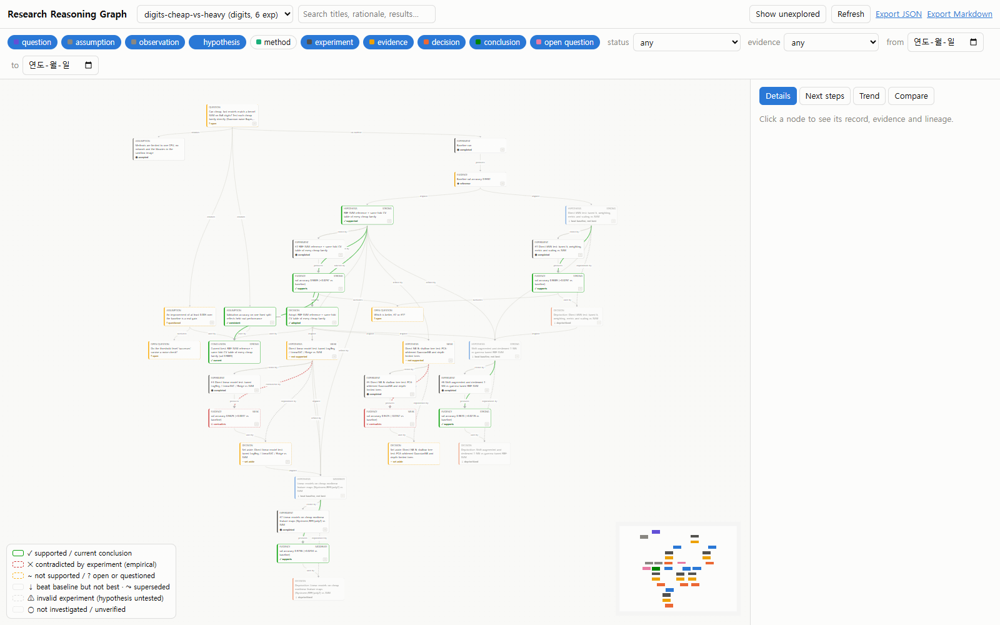
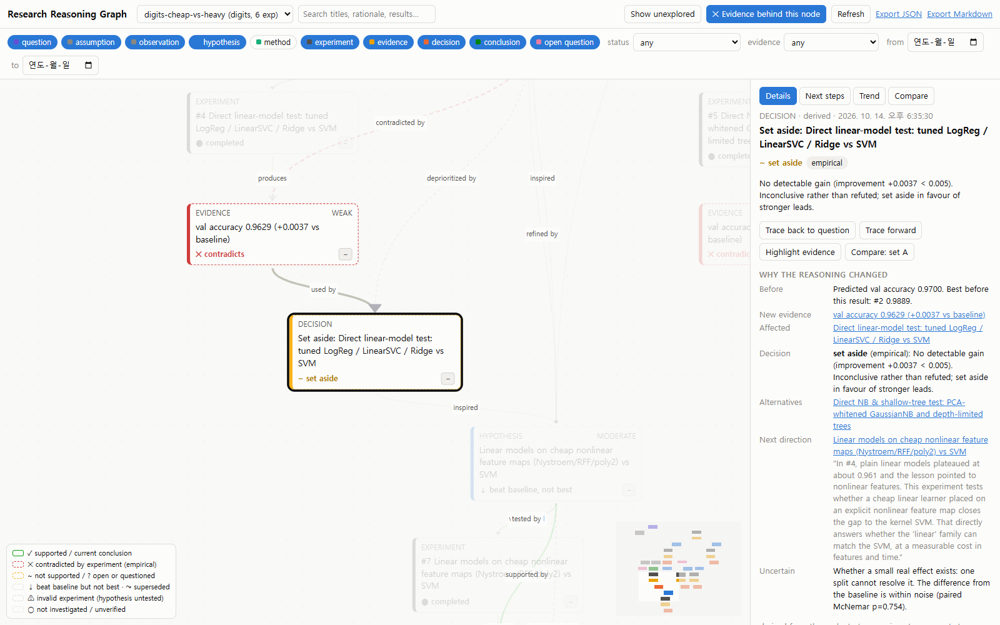

# Research Reasoning Graph

The graph answers one question about a run: **how did we arrive at this conclusion, which
alternatives did we consider, and exactly what evidence made us narrow or change direction?**

It is built from what the loop already records: runs, hypotheses, experiments, code versions,
executions and LLM calls. It does not try to reconstruct hidden model reasoning. Every text field
is one of two kinds:
- **recorded:** quoted from what an agent wrote, such as a hypothesis rationale or the analyst's notes.
- **derived:** computed from scores and timestamps.

Each node says which kind it is.

Status: **Phase 1 is complete.** It covers the data model, graph generation from existing records,
and an interactive viewer. Phases 2–4 are not started (see [Next improvements](#next-improvements)).

```powershell
.venv\Scripts\python -m research graph serve                                  # viewer at http://127.0.0.1:8765/
.venv\Scripts\python -m research graph build  configs/digits-cheap-vs-heavy.toml   # (re)derive + summary
.venv\Scripts\python -m research graph export configs/digits-cheap-vs-heavy.toml --format md -o narrative.md
.venv\Scripts\python -m research graph export configs/digits-cheap-vs-heavy.toml --format json -o graph.json
```

## Data model

Two tables are added to each run's existing SQLite database. Nothing else in the schema changes.

| Table | Columns that matter |
|---|---|
| `graph_nodes` | `id` (persistent), `type`, `title`, `summary`, `status`, `confidence`, `epistemic`, `details_json`, `source_table`/`source_id` (the record it came from), `origin` (`derived` or anything else, e.g. `manual`), `created_at` |
| `graph_edges` | `id` = `src|rel|dst`, `rel`, `explanation`, `evidence_json` (ids of the evidence nodes behind it), `origin`, `created_at`, `stale` |

**Node types:** `QUESTION`, `ASSUMPTION`, `OBSERVATION`, `HYPOTHESIS`, `METHOD`, `EXPERIMENT`,
`EVIDENCE`, `DECISION`, `CONCLUSION` and `OPEN_QUESTION`. `OBSERVATION` is in the model but is
never derived automatically. It is there for manually added facts.

**Relations** read as "src *rel* dst":
- **Core:** `motivates`, `assumes`, `proposes`, `tests`, `supports`, `contradicts`, `refines`, `supersedes`, `depends_on`, `inspired_by` and `rules_out`.
- **Additions:** three, kept separate so weak evidence is never phrased as a proof:
  - `produces`: experiment → its evidence.
  - `selects`: decision → the hypothesis adopted as best.
  - `deprioritizes`: decision → a hypothesis set aside.

Each relation also has a *flow* direction, from cause to effect in the reasoning. Layout,
"trace back", "trace forward" and collapsing all use it, so arrows always point from the question
towards the conclusions.

**IDs are deterministic.** They look like `r{run}:{kind}:{key}`, for example `r1:hyp:4` or
`r1:evidence:e5`, so they stay the same across rebuilds and can be referenced from outside.

**Persistence is additive:**
- **Rebuilding:** a rebuild is an upsert.
- **Stale rows:** a derived node that no longer follows from the records becomes `stale` and is never deleted. A derived edge that is no longer produced is flagged `stale` and is left out when loading.
- **Manual rows:** rows whose `origin` is not `derived` are never modified by a rebuild.
- **Rejected branches:** these are always kept, because they are derived from immutable experiment records.

## How each node is derived

| Node | From | Notes |
|---|---|---|
| QUESTION | `runs.objective` | One per run. |
| ASSUMPTION | the run config and domain | "validation is a proxy for held-out", "the success threshold is a real gain", "sandbox limits". The first two are **checked** against the data (val/test rank correlation; threshold vs. standard error) and marked `consistent` or `questioned`. They are never marked proven. |
| HYPOTHESIS + METHOD | `hypotheses` | The rationale and method are recorded text. `parent_experiment_ids` become `inspired_by` edges (to the parent's decision) and `refines` edges (to the parent hypothesis). |
| EXPERIMENT | `experiments` | Links to code versions, executions, LLM calls, seed and workspace. |
| EVIDENCE | scored experiment | Validation and test score, improvement, and **paired McNemar test** vs. the baseline (see below). A failed run gives `invalid` evidence with **no** edge to its hypothesis. |
| DECISION | each finished experiment | `before`, `alternatives` (other hypotheses from the same researcher call), `new_evidence`, `affected`, `why`, `why_next` (later hypotheses citing this result, with the researcher's quoted rationale) and `uncertain`. |
| CONCLUSION | each new best, in completion order | Each new best `supersedes` the previous one, which stays as `superseded`. |
| OPEN_QUESTION | statistics | Top results that are statistically tied, and a threshold that is below the noise level. |

### Kinds of negative result

The builder keeps these apart and never merges them:

| Status | Meaning | Rule |
|---|---|---|
| `contradicted` | Empirically contradicted | Significantly **worse** than the baseline (paired p < 0.05). The text says "not shown to be impossible". |
| `not_supported` | Inconclusive | Missed the success threshold, but the difference is within noise. "Set aside", not refuted. |
| `supported_not_best` | Benchmark ranking only | Beat the baseline, but tied or trailed the current best. "Deprioritized", not refuted. |
| `untested_invalid` | Invalid experiment | The program never produced a score, so the hypothesis is still untested. |
| `not_investigated` | Never run | Still queued when the run stopped. |

`rules_out` and `epistemic = "formal"` are **never** produced automatically. They are reserved for
manually recorded proofs.

### Evidence strength

When the metric is accuracy, each attempt's `val_pred.csv` is still in the run workspace, and the
held-out labels are available locally, two experiments are compared with an **exact paired McNemar
test**. It uses only the validation examples where the two models disagree. This is much more
sensitive than comparing two accuracies, and it is honest about ties: identical predictions give
p = 1.

| p-value | Strength |
|---|---|
| p < 0.003 | strong |
| p < 0.05 | moderate |
| otherwise | weak |

Without the workspace, or for other metrics, an unpaired normal approximation is used instead and
labelled as such. Either way, everything rests on **one validation split**, and the text says so.

## The viewer

`viewer/` is plain HTML and JS: React 18, React Flow 11, dagre and htm, vendored as pinned UMD files.
It needs no npm and no build step, and it works offline. `research/viewer_server.py` is a stdlib
HTTP server bound to 127.0.0.1 that serves the viewer and this JSON API:

| Endpoint | Returns |
|---|---|
| `/api/runs` | every run in every `runs/*.db` |
| `/api/graph?db=&run=` | re-derives, persists and returns the graph, plus next steps and the score trend |
| `/api/node?db=&run=&id=` | node, edges, path to question; for experiments also code versions, execution logs, LLM calls |
| `/api/trace?...&id=&dir=back\|fwd` | ancestors or descendants (nodes and edges) |
| `/api/compare?...&a=&b=` | the downstream lines of two nodes side by side |
| `/api/export.json`, `/api/export.md` | downloads |

Features:
- **Navigation:** pan and zoom, a minimap, and search across titles, rationales and results.
- **Collapse:** collapse a branch to hide everything that is only reachable through it.
- **Filters:** by node type (hidden types are *bridged*, so the question stays connected), status, evidence strength and date. Each run in the selector is one research domain.
- **Details:** click a node for its record, decision fields, relationships, code versions and logs.
- **Tracing:** "Trace back to question", "Trace forward", and "Highlight evidence", which lights the exact evidence behind a decision.
- **Unexplored:** "Show unexplored" highlights untested, unverified and open nodes.
- **Compare:** two lines of research side by side.
- **Trend:** a validation/test chart with best-so-far and the baseline, with a table view.
- **Next steps** and export.

Visual encoding: the node type is a coloured stripe **and** a text label. The status is a border
style **and** an icon **and** a word, so meaning never rests on colour alone. Light and dark
themes follow the OS.

## Worked example: `digits-cheap-vs-heavy` (real run)

The [configs/digits-cheap-vs-heavy.toml](../configs/digits-cheap-vs-heavy.toml) run asked Claude,
through the headless Claude Code adapter: *"Can cheap, fast models match a kernel SVM on 8x8
digits? Test each cheap family directly…"*. It ran 6 experiments plus the baseline, at an
estimated $0.97 of subscription usage. The graph, narrative and screenshots in
[docs/sample-graph/](sample-graph/) were generated from those persisted records by
`python -m research graph export`.



What the viewer shows for each required question:

- **Why the selected method was chosen.** Click the current CONCLUSION and press "Trace back to question". The path runs question → baseline (0.9592) → *RBF-SVM reference* hypothesis → experiment #2 → evidence 0.9889 (+0.0297, paired McNemar p = 0.00003, strong) → conclusion. The adopt decision records "Best validation accuracy so far".
- **Why an alternative was set aside.** Click the decision on *Direct NB & shallow-tree test*. It was lower than the baseline (−0.0167), but **not significantly** (p = 0.136). It is therefore *set aside, inconclusive*, not "contradicted" and certainly not "impossible". The panel also notes that the researcher had *predicted* 0.940 and measured 0.9425, so its own prediction held. "Highlight evidence" lights exactly that evidence node.
  
- **Which experiments support the current conclusion.** These are the `supports` edges into the conclusion and the trace-back set. The trend tab shows held-out test scores beside validation scores.
- **Which assumptions remain unverified.**
  - The 0.005 success threshold is *questioned*: it is below the noise level of 539 validation examples.
  - "Validation reflects held-out" is *consistent*: the rank correlation is 0.89 across 7 runs. That checks the assumption; it does not prove it.
- **What the next experiment should investigate.** The Next steps tab puts first: *"Which is better, #2 or #3?"* The kNN hypothesis (#3, a cheap model) scored **the same** as the RBF-SVM: they disagree on only 4 of 539 validation examples, 2 each way (p = 1). That is the actual answer to the research question so far: on this split, a tuned kNN matches the kernel SVM. The tie-break to "current best" is just which finished first. The suggested experiment is a repeated-CV or multi-seed comparison.

In this run, the branch that is *contradicted by experiment* (significantly worse than the
baseline) does not appear. The weaker branches are labelled honestly instead. The test suite
covers a contradicted branch alongside supported, deprioritized, invalid, inconclusive and
not-investigated ones, using records from a full controller run
([tests/test_graph.py](../tests/test_graph.py)).

## Design tradeoffs

- **Derived, not captured (yet).** Phase 1 reconstructs decisions from records that already exist. That works for every past run immediately and cannot drift from the records. The cost is that alternatives are limited to hypotheses proposed in the same researcher call, and "why next" is the researcher's rationale, not a statement made at decision time. Phase 2 would capture decisions live.
- **The numeric outcome is the decision.** The loop's success rule ("beat the baseline by `min_improvement`") drives the verdicts, so the graph never disagrees with the evaluator. The analyst's verdict and lessons are shown as commentary only. A hypothesis that was really a question ("does X match Y?") is still judged by that rule. The graph flags this when the researcher's own prediction held.
- **Same database, additive tables.** There is no new datastore or service. Large artifacts (code, logs, predictions) stay where the loop already puts them: code and log tails in SQLite, full outputs under `runs/<name>/exp_NNNN/`. Graph nodes reference them by id and path.
- **Rebuilt on every view.** Each graph request re-derives the graph, which is idempotent and takes milliseconds for runs of this size. The viewer therefore shows runs still in progress without any hooks into the controller. For runs with thousands of experiments this would need incremental derivation.
- **No build toolchain.** Vendored UMD files and `htm` instead of JSX and a bundler mean nothing to install and it works offline. The cost is no TypeScript and one larger `app.js`.
- **No vector database.** Search is keyword search over titles, rationales and details, plus graph traversal, as the spec asks.

## Orchestration (spec §7): one agent or three?

I investigated this by reading the code; no change was made.

- **What "three agents" means today.** Researcher, coder and analyst are already *not* separate agents. They are three prompt templates with their own JSON schemas, called through one `LLM` object (`research/llm.py`). There is no agent framework to remove.
- **What merging would gain.** One Claude Code session per run (`claude -p --resume <session>`) would give the coder the researcher's reasoning, and the analyst the coder's, without re-sending history.
- **What merging would cost:**
  - **Concurrency.** Two workers would have to share one session, so phases would serialise.
  - **Context growth.** Context, and therefore cost, grows with every experiment instead of staying bounded per call.
  - **Validation.** Per-phase schema validation is harder to keep strict.
  - **Independent review.** The analyst would grade its own idea.
- **Recommendation.** Keep the three phases as stateless structured calls. Keep the executor, sandbox, trusted evaluator and persistence deterministic, as they are now. If merging is still interesting, test it before adopting it: fixed budget, same domain and seeds, comparing best validation score reached per dollar and the rate of invalid programs.

## Limitations

- **Decisions:** they are reconstructed after the fact (see tradeoffs). Rejected alternatives the researcher considered but never wrote down are invisible.
- **Statistics:**
  - The paired test is only used for accuracy with per-example predictions on disk. Other metrics fall back to the unpaired approximation.
  - All comparisons use one validation split.
  - Many comparisons are made, with no multiple-testing correction.
- **Assumption checks are coarse.** For example, the rank correlation over a handful of runs is noisy.
- **Read-only viewer.** It has no editing UI. Manual nodes and edges (OBSERVATION, formal proofs, `rules_out`) currently have to be inserted into the tables directly, and are then preserved and shown.
- **Layout:** dagre re-lays the whole graph on every filter change. Very large runs (hundreds of experiments) get wide.
- **No cross-run comparison:** comparing lines from two different runs is not supported.
- **Security:** the server is for local use only. It has no authentication and binds to 127.0.0.1.

## Next improvements

1. **Phase 2: capture decisions live.** Extend the researcher's schema with explicit `considered_alternatives`, `rejected_because`, `assumptions_touched` and `uncertain`, and write them as `recorded` DECISION nodes when hypotheses are proposed. Add historical replay: a time slider over `created_at` that shows the graph as it was after experiment *k*.
2. **Repeated-CV / multi-seed "noise check" experiments.** The Next-steps tab already proposes them. Add them as a first-class experiment type so open questions can be closed.
3. **Phase 3: method cards from literature.** Use permitted sources only, and store bibliographic provenance and quoted passages as EVIDENCE with `source` details. Never fabricate.
4. **Phase 4: retrieval and prioritisation.** Rank memories separately by relevance, evidence strength, information value and recency, without discounting negative results. Feed that ranking to the researcher.
5. **A small editing API** for manual OBSERVATION and CONCLUSION nodes and formal `rules_out` edges.
